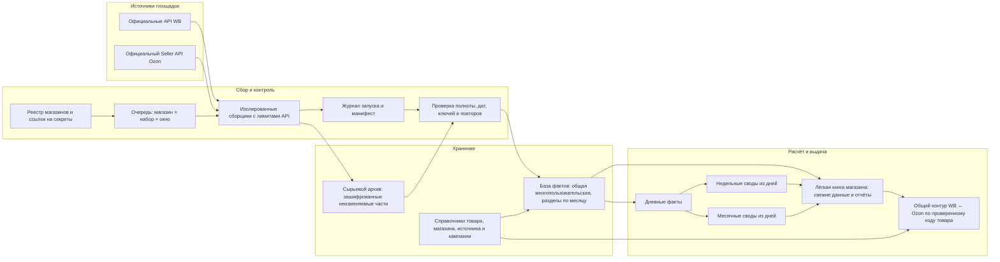

# Масштабируемое хранение и движение данных WB / Ozon

Актуализировано: 2026-10-12. Документ разделяет подтверждённое текущее состояние и целевое устройство для сотен кабинетов. Наличие нарисованной схемы не означает, что целевая база уже развёрнута.

## Карта целевой системы



**Поток:** площадка → маленькое задание на магазин и период → точный ответ источника в архив → проверка и запись фактов с естественным ключом → своды, которые читают только нужный период → лёгкие таблицы для анализа.

Рабочая таблица не является сырьевым архивом или базой. Историю любого срока можно заново обработать из архива, но в обычном обновлении загружается только изменившееся окно.

## Что уже работает и что доказано

| Линия | Сейчас | Подтверждённое ограничение |
|---|---|---|
| WB: реклама и воронка | GitHub Actions собирает через официальные API; шифрованное состояние хранится одной заменяемой выгрузкой в ветке `traffic-state`; мост публикует нормализованные строки | Это не архив неизменённых ответов API и не рассчитанное на бесконечное накопление хранилище. На 12.10 окно рекламы было 01–12.10, воронки — 06–12.10; итог `complete=false` из-за 400 рекламных кампаний AIR с ответом `null`. Значения не заменялись нулями. |
| WB: рекламные запросы и настройки кампаний | Собраны отдельными наборами; за 12.10 присутствуют 13 467 исторических строк рекламных запросов и 545 строк настроек кампаний в шифрованном состоянии | Регулярное помещение всех наборов в долговечные факты ещё не принято сквозной проверкой. |
| WB: поисковые позиции | Публикация фактических снимков; AIR — 2 007 строк по состоянию на 11.10 | Хозяюшка недоступна с точной причиной `JAM_REQUIRED_PUBLIC_SERP_BLOCKED`; Саныч не подключён в эту линию. Недоступность не является нулём. |
| WB: финансы | Отдельный сбор начислений с окном 30 дней; выгрузка шифруется в ветку `finance-state` | Шифрованная выгрузка ещё не заменяет факты и отчёты в таблицах магазина. |
| WB: заказы, остатки и расчётные листы | Старый обработчик Apps Script пишет в книги магазинов и семейство `90_RAW_*` | Саныч достиг предела изменения крупной книги. API Google отказал даже в удалении пустого хвоста; копирование книги двумя попытками не удалось. Исходные строки не удалялись. |
| WB: трафик по магазинам | В старых книгах есть отдельный писатель, который обновляет `90_RAW_traffic`, затем пересобирает дневной лист и витрину. У Саныча исторические строки 24.09–08.10 сверены с двумя месячными слепками | Эти строки — уже нормализованные записи, не точные ответы API. Месячные части ещё требуется доказать чтением после публикации; до такой проверки слепки не считаются новым рабочим источником. |
| Ozon: радар поиска | Отдельный радар поисковых позиций | Он не собирает заказы, продажи, остатки и финансы Seller API. |
| Ozon: данные кабинетов | Созданы две отдельные книги-шаблона | Регулярный сбор Seller API не подтверждён. Наличие ключей в переписке не доказывает наличие двух изолированных полномочий в защищённом хранилище. |

### Трафик и реклама — точность вычислений

- Рекламные клики берутся из официального рекламного источника.
- Органические клики можно вычислять как «общие клики − рекламные клики» только при одинаковых магазине, товаре, дате, канале и зерне обеих исходных величин. Если период или зерно различаются либо источник неполон, органика остаётся неизвестной.
- Нулевые значения публикуются только если источник явно вернул ноль. Пустой, недоступный, частичный или ошибочный ответ хранится со своим статусом.
- Дневной факт продаж, заказов, воронки, рекламы, трафика, начислений, остатка и поиска имеет отдельное описание источника и единиц. Недельные и месячные показатели рассчитываются из принятых дневных фактов; копии одних и тех же строк не служат второй «истиной».
- Наблюдения внутри дня содержат время снимка и не подменяют итог дня.

## Целевое хранение для сотен кабинетов

### Сырьё

Отдельное объектное хранилище, а не Google Sheets и не ветка GitHub. Хранить ответ API без изменения, с шифрованием и ограниченным доступом. Каждая часть сжата и неизменяема. Пример каталога:

```text
raw/v1/platform=wb/shop=<shop_id>/dataset=<dataset>/date=YYYY-MM-DD/run=<run_id>/part-0001.jsonl.gz
```

Для каждого файла сохраняется манифест: магазин, площадка, набор, точный маршрут источника, окно запроса, время получения, версия формата, число записей, границы дат, отпечаток содержимого, результат чтения и проверки. Ошибка API, пустой успешный ответ и отсутствие права — три разные записи состояния.

Части закрываются по меньшему из заданных порогов байтов, строк или времени обработки. Историческое сырьё не перечитывается при каждом дневном запуске. Срок и способ хранения утверждаются для каждого вида данных отдельно.

### База фактов

Одна общая база с разделением по магазину и площадке, а не отдельная база или копия полного сырья на каждого клиента. База хранит проверенные факты и ссылки на сырьевые части.

Минимальные наборы фактов:

- `fact_sales_daily`: заказы, продажи, выручка и выкуп;
- `fact_funnel_daily`: шаги воронки и их исходные знаменатели;
- `fact_ads_daily`: кампания, товар, показы, клики, расходы и рекламные заказы;
- `fact_traffic_daily`: общие и канальные клики с источником и детализацией;
- `fact_finance_daily`: начисления, удержания и выплаты с кодом исходного типа;
- `fact_stock_snapshot`: товар, склад, остаток и время снимка;
- `fact_search_snapshot`: запрос, товар, позиция и время снимка;
- `product_identity`: подтверждённые пары идентификаторов WB и Ozon;
- `run_manifest`: состояние, полнота и контрольные суммы каждого задания.

Ключ факта включает площадку, магазин, тип набора и естественное зерно исходной записи (например, дата + товар + канал либо дата + кампания + товар). Повторный запуск обновляет ту же версию по ключу; исправление источника оставляет ссылку на прежний сырой ответ. Снимки остатков и позиций дополнительно ключуются временем наблюдения.

Физическое разбиение базы — по месяцу даты факта; крупные наборы могут дробиться на части. Перенос старых разделов делается по манифесту и проверенным отпечаткам. В запросе читаются только нужный магазин, набор и период.

### Своды и клиентские таблицы

- Дни — первичная аналитическая витрина. Недели и месяцы строятся из них без повторной загрузки сырых строк.
- Книга магазина показывает свежие дни (например, последние 90 дней), недельную историю, месячные итоги, карточку качества и ссылки на источник. Долгая история остаётся в базе и архиве, а не растит число строк листа бесконечно.
- Общий контур читает принятые показатели нескольких магазинов. Соединение WB и Ozon выполняется только по подтверждённому устойчивому коду товара; неоднозначные соответствия находятся отдельно и не смешиваются.
- Для сотен магазинов используется реестр и очередь заданий: один и тот же код сборщика работает с разными настройками магазина. Ограничения частоты, повторные попытки, блокировки от одновременной обработки, карантин неразобранных ответов и показатели объёма задаются явно.
- Секреты лежат только в защищённом хранилище и представлены в реестре ссылкой, а не значением. Доступ к фактам ограничен магазином и его владельцем.

Google Sheets остаётся удобным интерфейсом и экспортом. Он не хранит все кабинеты, месяцы, сырые ответы и промежуточные копии.

## Порядок перехода без потери истории

1. **Завершить текущий маршрут WB-рекламы и воронки.** Исправить адреса папок частей, дождаться публикации, прочитать закрытые строки и манифесты по всем трём магазинам. Проверить даты, числа, уникальность ключей, источник, повторный upsert и отсутствие повторной записи в большую HUB-книгу.
2. **Перенести сбор трафика с одного rolling-файла.** Сейчас ветка `traffic-state` содержит заменяемый шифрованный снимок всей собранной истории. Это временная страховка, не бесконечный архив. Новые части и манифесты принимать по мере записи; исторические записи сверить до смены читателя.
3. **Освободить Саныча через отдельное рабочее хранилище.** Нельзя чинить старую книгу удалением данных, пока Google отклоняет запись. Перенести нужные листы малыми диапазонами в новую лёгкую книгу/базу, проверить строки, формулы и ключи, затем переключить указатели писателя и читателя. Старую книгу оставить неизменённым архивом до приёмки.
4. **Перевести остальные линии отдельно:** заказы, остатки, финансы, поиск и поставки. Для каждого набора — собственные правила ключа, полноты, источника и корректировок; после миграции читать факты из нового слоя, не из старых огромных листов.
5. **Подключить Ozon Seller API только после проверки двух кабинетных полномочий в защищённом хранилище.** Сначала сбор одного кабинета в отдельное пространство данных, затем второй; поисковый радар остаётся самостоятельным источником.
6. **Сделать общие своды и сопоставление товаров.** Публиковать отчёты после независимой сверки метрик WB и Ozon, не складывать разные зерно, периоды или определения показателей.
7. **Архивировать старые листы и убирать только после приёмки.** Для каждой регулярной линии нужны три успешных плановых выполнения подряд; ручной запуск эту серию не заменяет.

## Что не следует выдавать за сделанное

Сейчас реальный долгосрочный объектный архив, общая база фактов, адаптер Ozon Seller API, безопасное подключение секретов двух кабинетов и общие таблицы сравнения не развёрнуты. Ограничение Railway-развёртывания сохраняется; этот документ не подключает платное хранилище и не меняет ставки, бюджеты, цены или исходные таблицы.

## Условия приёмки

Для каждого кабинета и каждой плановой линии сохраняются три последовательных плановых успешных запуска. Для каждого сравниваются: окно источника, крайняя дата, количество полученных и записанных строк, уникальность естественного ключа, контрольная сумма сырья, число новых и обновлённых фактов, недоступные поля, время публикации и прочитанные обратно строки. Успех API сам по себе не доказывает, что строки оказались в нужной книге. Отсутствующие значения не превращаются в нули.
