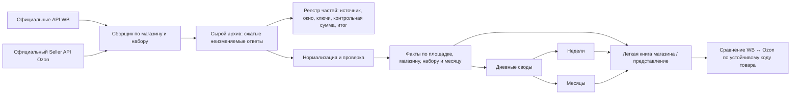

# Хранилище и движение данных WB / Ozon

Актуализировано: 2026-10-12. Основано на коде ветки `mainggg`, расписаниях GitHub Actions, реестре хранилища и фактически проверенных книгах. Это схема состояния системы и целевой порядок перехода, а не заявление о готовности.

## Требуемое состояние

Сборщик получает официальный ответ площадки, сохраняет проверяемую исходную запись, затем строит нормализованные факты. Только факты идут в компактные дневные, недельные и месячные своды. Рабочие книги не являются архивом и не должны повторно принимать тот же многолетний массив. Повторный запуск обновляет одну запись по естественному ключу; отдельные наблюдения накапливаются только там, где важен ход изменения внутри дня.

## Фактические маршруты сейчас

| Линия | Источник и сборщик | Что записывается сейчас | Ограничение |
|---|---|---|---|
| Реклама | WB `/adv/v3/fullstats`, `wb_worker/traffic_sync.py` | Нормализованные дневные строки и часовые наблюдения; рабочая книга WB AI HUB; зашифрованная ветка `traffic-state`; месячные части Google Sheets для рекламы и наблюдений уже предусмотрены | Загрузка в месячные части выполняется перед второй записью в крупные листы HUB. Крупная книга Саныча почти заполнена, поэтому эта повторная запись не нужна и может сорвать весь запуск. |
| Воронка | WB Seller Analytics `/api/v2/supplier/sales-funnel/products/history` | Дневные строки и часовые наблюдения тем же сборщиком | Та же повторная запись в HUB. Текущий архив сохраняет нормализованный экспорт, а не исходные байты ответа WB. |
| Поисковые позиции | `wb_worker/github_search_snapshot_sync.py`; Seller Analytics для AIR, публичная выдача как отдельный источник для кабинета без доступа Seller Analytics | Проверенные снимки позиций публикуются в книги магазинов | Публичный источник Хозяюшки сейчас отвечает 403; это «источник недоступен», не нулевые позиции. Саныч отсутствует в списке этой линии. |
| Финансовые начисления | WB Finance API, `wb_worker/github_finance_charges_sync.py` | `charges_all.csv` и штрафы шифруются в ветку `finance-state` | Регулярная запись этих выгрузок в помесячные книги фактов не подключена. |
| Заказы, остатки, снабжение и расчётные листы | Клиентский обработчик Apps Script из `sellmonitor_github_worker/SELLMONITOR_GITHUB_WORKER.gs`; отдельный `wb-api-worker`; месячные отчёты в старых книгах | Очереди команд и листы семейства `90_RAW_*`, RNP и рабочие своды; отдельные API выгрузки доступны из `wb-api-worker` | Слишком много сырых листов в одной книге; централизованный месячный путь фактов для этих наборов не подключён. |
| Ozon — радар | `ozon_radar`, `ozon_live`, `ozon_radar_server` | Поисковые позиции из витрины и локальное состояние радара | Это не Seller API и не даёт заказы, продажи, остатки или начисления. |
| Ozon — магазинные факты | Два файла-шаблона | Шаблоны вкладок | Регулярного чтения Seller API и записи магазинных фактов пока не подтверждено; безопасные ключи кабинетов в защищённом хранилище не подтверждены. |

## Целевая физическая раскладка

- **Реестр магазинов и наборов:** стабильный идентификатор магазина, площадка, разрешённые наборы, ссылка на секрет в хранилище, расписание, состояние и версия схемы. Сам секрет хранится только в защищённых переменных/хранилище.
- **Архив исходных ответов:** сжатые неизменяемые части с путём вида `raw/<площадка>/<магазин>/<набор>/<год>/<месяц>/<запуск>-<часть>.jsonl.gz`. Каждая запись сохраняет адрес источника, время получения, окно запроса и отпечаток. Если площадка вернула ошибку или пустой ответ, это отдельный итог запуска, а не запись с нулями.
- **Реестр частей:** одна строка на часть; площадка, магазин, набор, слой, период, файл, схема, источник, запуск, число строк и уникальных ключей, минимальная/максимальная дата, контрольная сумма, проверка и замена старой части.
- **Нормализованные факты:** идемпотентная запись по ключу `площадка + магазин + набор + дата + товар + источник/кампания`. Срезы, накопленные внутри дня, имеют отдельный ключ с временем наблюдения и не заменяют дневной факт.
- **Физические разделы:** месяц и набор — базовое разбиение; крупный раздел дополнительно делится по магазину или номеру части до записи. Каждая часть остаётся ниже лимита ячеек, а реестр позволяет найти нужный диапазон без открытия всего архива.
- **Своды:** день является основой недель и месяцев. Их пересчёт читает только нужный магазин и период. Рабочая книга магазина содержит карточку качества, актуальные факты и выбранные своды, а не повтор архива и всех промежуточных расчётов.
- **Сопоставление товаров:** только по подтверждённому устойчивому идентификатору (штрихкод/артикул продавца с таблицей соответствий и историей изменений). Неоднозначное совпадение не объединяется автоматически.

## Порядок безопасного перехода

1. Переключить рекламу и воронку на запись **только в месячные части**. Сохранить маленький итог качества и фактические количества; не переписывать те же строки в `12_ADS_CAMPAIGN_DAY`, `13_FUNNEL_DAY`, `15_ADS_POLL_SNAPSHOT`, `16_FUNNEL_POLL_SNAPSHOT`.
2. Проверить строки в частях для каждого магазина: даты, число полученных строк, естественные ключи, дубли, максимальную дату, источник и отпечаток. Старые книги пока не очищать.
3. После успешных плановых прогонов перенести финансовые начисления, поиск, заказы и остатки в такой же путь «архив → факты → своды». Каждую линию включать отдельно и проверять независимые итоги с источником.
4. Только после сравнения фактов и сводов перенести рабочие листы на чтение новых частей. Сохранить старые книги как доступный архив; проверить ссылки и отчёты.
5. Для сотен клиентов не создавать лист на каждый запрос: сборщик обрабатывает магазин как запись реестра, задания имеют блокировку, повторы безопасны, а чтение ограничивается выбранными магазином и периодом. При приближении к установленному пределу часть закрывается и создаётся следующая; рост места и числа файлов измеряется до расширения.
6. Ozon подключать только после подтверждения двух раздельных прав Seller API в защищённом хранилище; радар не использовать как замену фактическим заказам и продажам.

## Условия приёмки

Для каждой регулярной линии и каждого магазина проверяются **три последовательных плановых запуска**; ручной или вызванный изменением кода запуск серию не заменяет. Для каждого запуска сравниваются закрытые строки с итогом сборщика: окно и максимальная дата, полнота по источникам, число строк, уникальность ключей, контрольная сумма, новые/обновлённые строки и статус. Неизвестные и недоступные значения остаются пустыми с точным состоянием источника. До этих доказательств линия не считается принятой.
